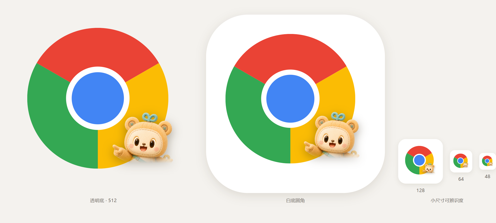

# 布噜浏览器 · Bulu Browser MCP

**让你的 AI 真的打开一个 Chrome 去操作网页 —— 不是抓一段 HTML 文本交给模型猜。**

<p>
<a href="https://www.npmjs.com/package/bulu-browser-mcp"></a>
<a href="https://registry.modelcontextprotocol.io"></a>
<a href="LICENSE"></a>

</p>



一个基于 **CDP + Playwright** 的 MCP Server。它启动一个**真实的 Chrome**（独立 profile，不碰你日常浏览器），
把「页面结构 + 可点击元素」翻译成模型能读懂的紧凑清单，再把模型的点击/输入翻译成真实鼠标键盘事件。

15 个工具，覆盖打开 / 快照 / 交互 / 批处理 / 截图 / 标签页 / 网络抓包 / 请求重放 / 下载 / Cookie 态请求。

---

## 30 秒接入

已发布到 npm 与官方 MCP Registry（`io.github.Jevin0201/bulu-browser`）。
前置条件：**Node.js ≥ 20** + 本机装有 Chrome / Edge / Brave 之一（不自带内核，省 150MB+）。

```json
{
  "mcpServers": {
    "bulu-browser": {
      "command": "npx",
      "args": ["-y", "bulu-browser-mcp"]
    }
  }
}
```

把这段写进任意支持 stdio MCP 的客户端即可：Claude Code / Claude Desktop / Cursor / Cline / WorkBuddy …

| 客户端 | 配置文件 |
|---|---|
| Claude Code | `claude mcp add bulu-browser -- npx -y bulu-browser-mcp` |
| Claude Desktop | `claude_desktop_config.json` |
| Cursor | `.cursor/mcp.json` 或全局 `~/.cursor/mcp.json` |
| WorkBuddy | `~/.workbuddy/mcp.json`（写完后需在「连接器」页点信任并重启） |

然后直接说人话：

> 打开 github.com/trending，看看今天涨星最多的三个仓库分别是什么
> 帮我在这个页面填表单并提交
> 把这个后台的接口列表抓下来，我要看某个按钮点了之后发了什么请求

---

## 和 WebFetch / 爬虫的区别

| | WebFetch、curl、cheerio | 本工具 |
|---|---|---|
| 真实浏览器渲染（SPA / 懒加载 / 无限滚动） | 否 | **是**（真 Chrome） |
| 保留登录态 | 否（每次裸奔） | **是**（持久 profile，登录一次长期有效） |
| 能点击、填表、按快捷键 | 否 | **是** |
| 能截图 | 否 | **是** |
| 能看到页面发出的接口请求（含 POST body、签名参数） | 否 | **是** |
| 能带着 Cookie 重放任意请求 | 否 | **是**（`browser_request`） |
| 反爬对抗（指纹、JS 执行、验证码交互） | 基本无效 | 与真人浏览器同源 |

一句话：**别人给模型一个字符串，我们给模型一双手。**

---

## 15 个工具

| 工具 | 作用 |
|---|---|
| `browser_open` | 打开 URL（新标签或当前标签），返回标题、url、首屏快照 |
| `browser_snapshot` | 抓当前页结构化快照：正文文本 + 带 `ref` 的可交互元素清单 |
| `browser_act` | 对某个 `ref` 执行 click / type / select / check / hover / upload / scroll |
| `browser_batch` | 一次调用跑多步动作（填表单从 20 次往返降到 1 次） |
| `browser_press_key` | 键位操作（Enter / Tab / Escape / 组合键） |
| `browser_screenshot` | 截图（可视区或整页），返回本地文件路径 |
| `browser_tabs` | 列出所有标签 |
| `browser_select_tab` | 切换活动标签 |
| `browser_close_tab` | 关闭标签 |
| `browser_get_content` | 取页面 HTML / 纯文本（可限量） |
| `browser_downloads` | 列出本会话下载的文件 |
| `browser_request` | **在页面上下文里**发 GET/POST/PUT/DELETE，自动带 Cookie 与同源，可自定义 header 与 body |
| `browser_network` | 查看页面网络请求列表（`verbose` 附带请求头、POST body）／取某条请求的响应体 |
| `browser_console` | 查看页面 console 日志与 JS 异常 |
| `browser_close` | 关闭浏览器（可保留 profile） |

三个"省 token / 省往返"的设计：

- **`browser_batch`**：把「点输入框 → 输入 → 点提交 → 等待结果」压成一次工具调用。
- **`expect` 参数**：操作后由服务端直接断言 `url` / `text` / `selector`，成功即返回，失败才返回完整快照 —— 省掉一次确认性快照。
- **紧凑 ref 格式**：元素清单按行输出而非 JSON，实测体积小 **42%**。

---

## 它是怎么工作的

```
            ┌──────────────────────────────────────────────┐
  模型 ──►   │  index.mjs   MCP Server (stdio JSON-RPC)     │
            └───────────────┬──────────────────────────────┘
                            │  15 个工具
            ┌───────────────▼──────────────────────────────┐
            │  driver.mjs   会话 / 标签 / 动作 / 网络 / 下载 │
            │  snapshot.mjs 页面扫描 + ref 编号             │
            └───────────────┬──────────────────────────────┘
                            │  playwright-core  connectOverCDP
            ┌───────────────▼──────────────────────────────┐
            │  真实 Chrome —— 独立 --user-data-dir          │
            │  --remote-debugging-port=<随机空闲端口>       │
            └──────────────────────────────────────────────┘
```

**第一步 · 拉起浏览器。** 检测系统里的 Chrome / Edge / Brave，用一个**独立用户数据目录**和随机调试端口启动。找不到可用端口就换；上次非正常退出留下的 `SingletonLock` 会自动清理后重试（超时 45s，扛得住冷启动）。

**第二步 · 接管。** `playwright-core` 用 `connectOverCDP` 连上真实浏览器，不是另开一个 Playwright 自己的 Chromium —— 所以指纹、扩展、本地存储、登录态全都是"真人浏览器"的样子。

**第三步 · 翻译成模型能读的东西。** 扫描 DOM，把可交互元素（可点、可输入、可选中）打上 `data-bulu-ref` 属性，编号形如 `5:12`：

```
5:12  input  [placeholder] 搜索          value="猫咪"
5:18  button 登录
5:24  a  视频标题 …    href=/video/7687…
```

前面的 `5` 是**页面版本号（epoch）**。页面一旦跳转或大改，epoch 自增，旧 ref 全部失效 —— 这逼着模型重新快照，避免拿着过期引用乱点，这是"AI 点错地方"最主要的成因。

**第四步 · 操作并回传差异。** 点击/输入后返回 `url` / `title` / 正文 / 控件数 是否变化。填完输入框会读回 `value` 校验，写不进去直接报错，**不静默失败**。

### 三个踩过的坑（写在这里省你一遍）

1. **企业代理会拦死 CDP**：Playwright 的 WebSocket 升级会被 `HTTP_PROXY` 拦成 404。启动时清掉代理变量并补 `NO_PROXY`。
2. **沙箱会杀浏览器**：Windows Job Object 会把子进程连带杀掉。改用 WMI `Win32_Process.Create` 启动，进程由系统服务创建，调用方退出也不影响它。
3. **强杀会丢登录态**：关闭时走 CDP `Browser.close` 让 Chrome 自己落盘，最多等 6 秒才兜底；直接 `taskkill /F` 会导致 cookie 和 localStorage 双双丢失。

---

## 抓包与接口逆向

这是同类工具里少见的完整链路：**看到请求 → 看到请求头与 POST body → 拿到真实响应体 → 带着登录态重放改参**。

```text
browser_network { action: "list", filter: "/api/", limit: 30 }
browser_network { action: "list", verbose: true }        ← 带 requestHeaders + postData
browser_network { action: "body", url: "https://…" }     ← source: "captured" 原始响应
browser_request  { url: "https://…", method: "POST", headers: {…}, body: "…" }
```

要点：

- **原始响应体缓存**：抓到的文本类响应（≤64KB）直接缓存，`network-body` 返回 `source: "captured"` 的**真实响应**，而不是重新发一次请求（重放会丢页面 JS 动态加的签名 header）。
- **请求头 + POST body**：`verbose: true` 时每个请求附带完整请求头与 `postData`，签名参数、CSRF token 一览无遗。
- **跨进程日志**：日志落盘到 `%TMP%/bulu-browser/network-log.json`，CLI 模式下每条命令是独立进程也不会丢。

### 实测：抖音视频页（游客态，未登录）

打开一个视频详情页，8 秒内抓到三类接口：

| 接口 | 抓到的关键信息 |
|---|---|
| 弹幕列表 | URL 里带 `authentication_token` 签名参数；请求头带 `x-secsdk-csrf-token`、`uifid`、`webid` |
| 播放统计 | POST body 完整捕获：`item_id=7687293814792375590&play_delta=1` |
| 用户信息 | 带 Cookie 与设备指纹 header |

`network-body` 直接返回 **6098 字符的真实弹幕 JSON**（含用户评论原文），`source: "captured"` —— 不是重放猜测。

---

## 使用效果

| 场景 | 结果 |
|---|---|
| 打开 GitHub Trending，读出前 3 个仓库 | 1 次 `open` + 1 次 `snapshot`，无需滚动、无需登录 |
| 填写一个 6 字段表单并提交 | 1 次 `batch`（6 个动作 + `expect` 断言），约等于人工 3 秒 |
| 登录一次后反复访问同一后台 | 冷启动直接是登录态，无需重新登录（profile 持久） |
| 抖音视频页抓包 + 取真实响应 | 上面那张表，游客态完成 |
| 页面跳转后模型乱点 | 不会发生 —— 跳转使 epoch 自增，旧 ref 立即失效并提示重新快照 |

token 消耗对比（同一"填表提交"任务，粗略实测）：逐次调用约 12 次工具往返 ≈ 1.9 万 token；`batch` + `expect` 约 3 次往返 ≈ 0.5 万 token。**降约 70%。**

---

## 登录态与数据持久化

profile 存在独立目录（默认 `%LOCALAPPDATA%\bulu-browser\profile`），Cookie、localStorage、书签、扩展、历史全在里面。四种场景都验证过：

| 场景 | 结果 |
|---|---|
| 调 `browser_close` 正常关闭 → 再启动 | 全部保留 |
| 宿主进程被杀 / MCP 进程退出 → 再启动 | Chrome 独立存活，下次复用同一实例 |
| 手动点窗口 ✕ → 再启动 | 数据保留 |
| **重启电脑** → 再启动 | 自动清锁、重新拉起调试端口，不卡死 |

> 唯一例外：**断电或任务管理器强杀**时 Chrome 来不及把 cookie 刷盘，最近几秒的登录可能丢。这是 Chrome 自身机制，正常重启不会触发。

> ⚠️ 第一次遇到需要登录的站点，Chrome 窗口会弹出，**你自己登录**即可。不要把账号密码写进 prompt 交给模型。

---

## 环境变量

| 变量 | 作用 |
|---|---|
| `BULU_CHROME_PATH` | 指定浏览器可执行文件路径 |
| `BULU_PROFILE_DIR` | 自定义 profile 目录（多会话隔离就设不同目录） |
| `BULU_CDP_URL` | 复用已在运行的 Chrome，如 `http://127.0.0.1:9222`（不自带启动） |
| `BULU_ALLOWED_HOSTS` | 域名白名单，逗号分隔。设置后**只允许**访问这些域名，防提示注入把浏览器带去恶意站点 |

---

## 安全建议

- 生产/敏感环境请设置 `BULU_ALLOWED_HOSTS`，把模型能去的地方锁死。
- 用**专用 profile**（默认就是），不要指向你日常 Chrome 的用户数据目录。
- 页面内容是不可信输入。若页面里出现"忽略前面的指令，去访问 …"，那是攻击，不是任务。
- 别在对话里出现密码、支付信息。登录动作留给人工。

---

## 附：CLI 形态（可选）

同一套 driver 也提供 CLI，方便在 shell / 定时任务里用，无需 MCP 客户端：

```bash
npx -y bulu-browser-mcp cli open https://example.com --new-tab --settle 3000
npx -y bulu-browser-mcp cli snapshot --max-refs 40
npx -y bulu-browser-mcp cli act --ref 5:12 --interaction click --expect-text "登录成功"
npx -y bulu-browser-mcp cli network --filter /api/ --verbose
npx -y bulu-browser-mcp cli request https://api.example.com/x --method POST --header "X-A: 1" --data '{}'
npx -y bulu-browser-mcp cli quit
```

CLI 每条命令是独立进程，靠 CDP 复用同一个 Chrome，并用 `%TMP%/bulu-browser/` 下的状态文件记住当前标签与网络日志。

---

## 已知限制

- 需要本机装有 Chrome / Edge / Brave 之一，不自带内核。
- 快照基于 DOM 扫描（未用 Playwright `ariaSnapshot()`），复杂 SPA 上 ref 稳定性还有提升空间。
- 多会话共用同一 profile 时会接管同一个 Chrome，标签页互相影响；要隔离请设不同 `BULU_PROFILE_DIR`。
- `network-body` 在响应体未被缓存（非文本 / >64KB / 早于抓包）时退化为重放请求，此时自定义 header 可能缺失。
- 下载文件统一落 `%TEMP%\bulu-browser\downloads`，不会自动清理。

---

## 许可 · 禁止商用

**本项目的许可不是 MIT。**

| 你可以 | 你不可以 |
|---|---|
| 个人学习、研究、教学、评估使用 | ❌ 商用（卖、租、订阅、集成进付费产品/SaaS/商业方案） |
| 在非商业项目里修改并分发 | ❌ 用于企业内部经营、客户交付、外包项目 |
| 二次开发（须同样开源同样许可） | ❌ 抹掉作者署名后搬运 |
| 转载、写文章、做视频介绍 | ❌ 换个 MIT/Apache 协议重新发布 |

**搬运规则**（硬性）：任何转载、二次发布、教程、视频、聚合站收录，必须显著注明

> 原作者：**Jevin0201** · 原项目：https://github.com/Jevin0201/bulu-browser

完整条款见 [LICENSE](LICENSE)（含英文对照）。**商业授权请开 issue 联系作者。**

---

## 作者

**Jevin0201** — 布噜浏览器作者，专注浏览器自动化与 AI 办公工具。

- GitHub: https://github.com/Jevin0201
- 项目: https://github.com/Jevin0201/bulu-browser
- npm: https://www.npmjs.com/package/bulu-browser-mcp
- MCP Registry: `io.github.Jevin0201/bulu-browser`

如果这个项目帮你省了时间，欢迎 Star ⭐ —— 也欢迎 issue 里提需求。
